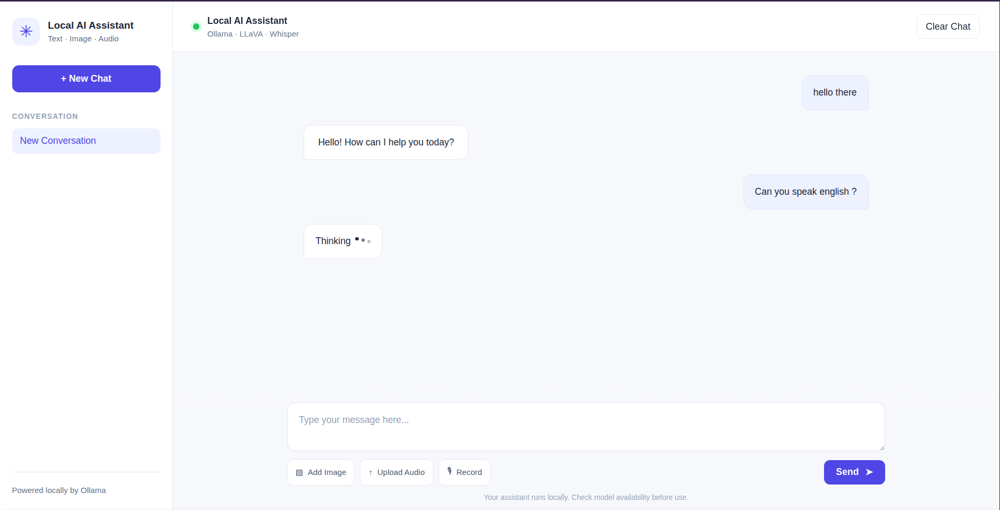

# LocalMind AI

**A local-first multimodal AI assistant for text, vision, and audio.**

LocalMind AI is a locally running AI assistant that brings text conversations, image analysis, and audio input together in a single web application. Built with FastAPI and powered by Ollama, LLaVA, and Whisper, the project explores how multimodal AI can run locally with an interactive web interface.

The project is under active development, with future plans for AI security, persistent memory, and multi-conversation management.

---

## Screenshots

### Main Interface

<p align="center">
  
</p>

### Text Chat

<p align="center">
  
</p>

### Image Analysis

<p align="center">
  
</p>

### Audio Input

<p align="center">
  
</p>

---

## Features

- **Text Chat** — Interact with a locally hosted AI model through a conversational interface.
- **Image Analysis** — Upload images and ask questions about their content.
- **Audio Input** — Upload audio or record your voice for transcription and processing.
- **Multimodal Requests** — Combine text, images, and audio in supported workflows.
- **Local Inference** — Run the vision-language model locally through Ollama.
- **Interactive Interface** — Chat-style layout with attachment previews, removable attachments, and loading indicators.

## Technology Stack

| Component | Technology |
|---|---|
| Backend | Python, FastAPI |
| Frontend | HTML, CSS, JavaScript |
| Model Runtime | Ollama |
| Vision-Language Model | LLaVA 7B |
| Speech Recognition | OpenAI Whisper |
| Templates | Jinja2 |

## Architecture

```text
                 LocalMind AI
                      |
               Web Interface
          HTML · CSS · JavaScript
                      |
                   FastAPI
                _____|_____
               |           |
          Text / Image    Audio
               |           |
             Ollama      Whisper
               |
            LLaVA 7B
               |
            AI Response
```

## Getting Started

### Prerequisites

- Python 3.10 or later, compatible with your installed dependencies
- [Ollama](https://ollama.com/)
- FFmpeg for audio processing
- Sufficient RAM and disk space for the selected local models

### 1. Clone the Repository

```bash
git clone https://github.com/moza369/localmind-ai.git
cd localmind-ai
```

### 2. Create a Virtual Environment

```bash
python3 -m venv .venv
source .venv/bin/activate
```

### 3. Install Dependencies

```bash
pip install -r requirements.txt
```

Install FFmpeg through your operating system's package manager if it is not already installed.

### 4. Download the Model

```bash
ollama pull llava:7b
```

Ensure Ollama is running before starting the application.

### 5. Run the Application

```bash
uvicorn app:app --reload
```

Open the application in your browser:

**http://127.0.0.1:8000**

> The development server is intended for local development and should not be exposed directly to untrusted networks.

## Project Structure

```text
localmind-ai/
├── app.py
├── services/
│   ├── __init__.py
│   └── transcription_service.py
├── static/
│   ├── script.js
│   └── style.css
├── templates/
│   └── index.html
├── docs/
│   └── images/
├── requirements.txt
├── .gitignore
├── .env.example
├── project.md
└── README.md
```

## Roadmap

The following items are planned for future development and are not yet claimed as implemented.

### Security and AI Security
- [ ] Validate uploaded files and enforce file-size limits.
- [ ] Improve temporary-file handling and error management.
- [ ] Review web application security and access to local services.
- [ ] Evaluate prompt injection and malicious instructions embedded in text, images, and audio.
- [ ] Add security tests and document mitigations.

### Conversation Management
- [ ] Support multiple independent conversations.
- [ ] Add persistent chat history.
- [ ] Allow users to create, switch between, rename, and delete chats.

### Persistent Memory
- [ ] Implement long-term memory across conversations.
- [ ] Separate current conversation context from saved memories.
- [ ] Allow users to inspect, edit, and delete stored memories.
- [ ] Add privacy controls for memory retention.

### Multimodal Improvements
- [ ] Improve combined text, image, and audio workflows.
- [ ] Improve transcription and error handling.
- [ ] Explore additional local models and configurable inference settings.
- [ ] Evaluate response quality and resource usage.

### Testing and Reliability
- [ ] Add automated backend tests.
- [ ] Test multimodal request combinations.
- [ ] Add security regression tests.
- [ ] Document setup and troubleshooting.

## Security and Privacy

Local inference reduces the need to send prompts to an external model provider, but it does not automatically make an application secure.

Uploaded files, model outputs, application endpoints, and local services still require appropriate safeguards. Security hardening is part of the project's roadmap.

## Contributing

Suggestions, bug reports, and contributions are welcome. Please open an issue to discuss significant changes before submitting a pull request.

## License

No license has been selected yet. A license will be added once the project's distribution and reuse terms are decided.
